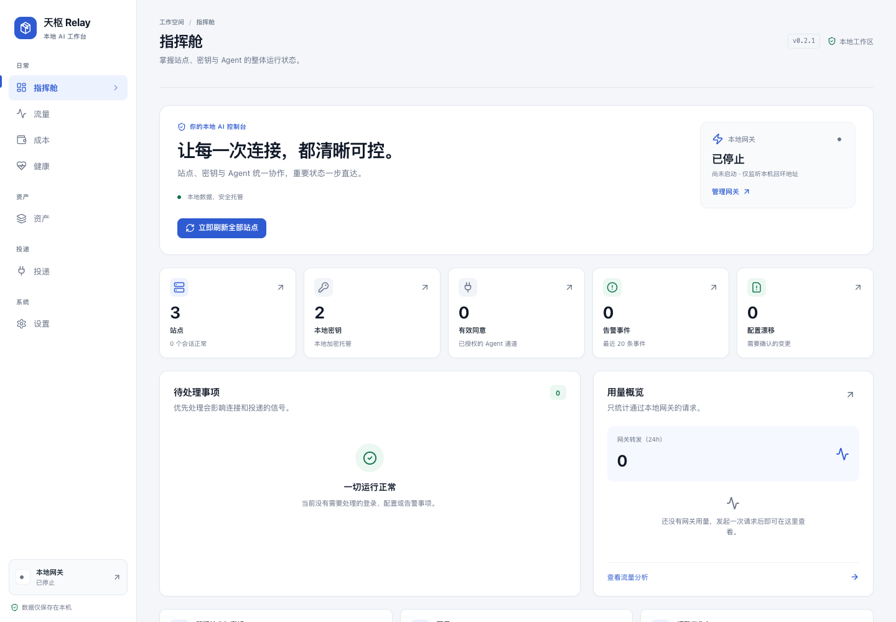
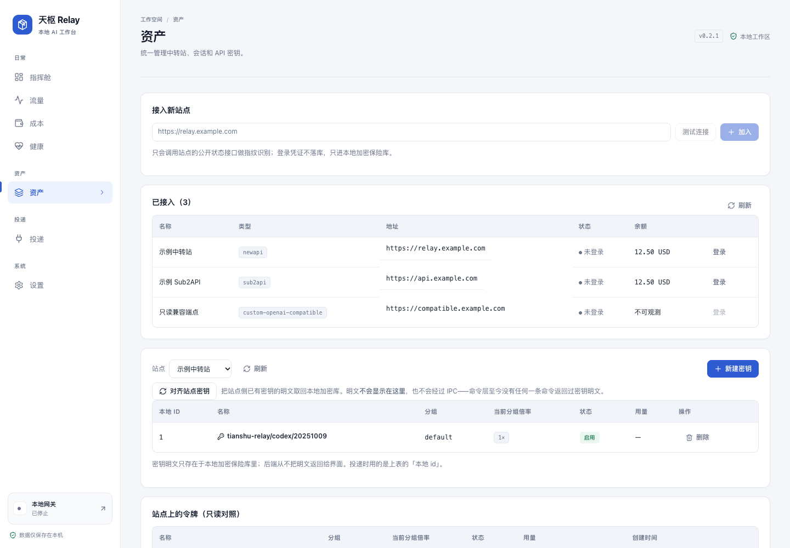
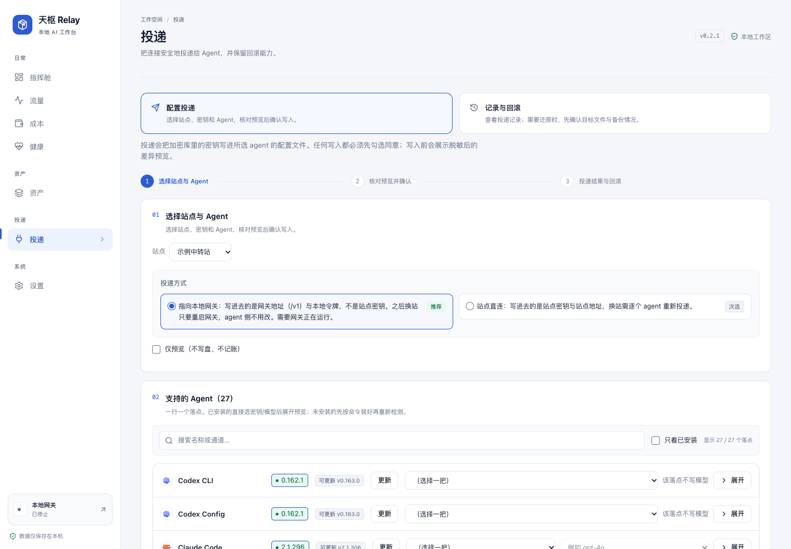
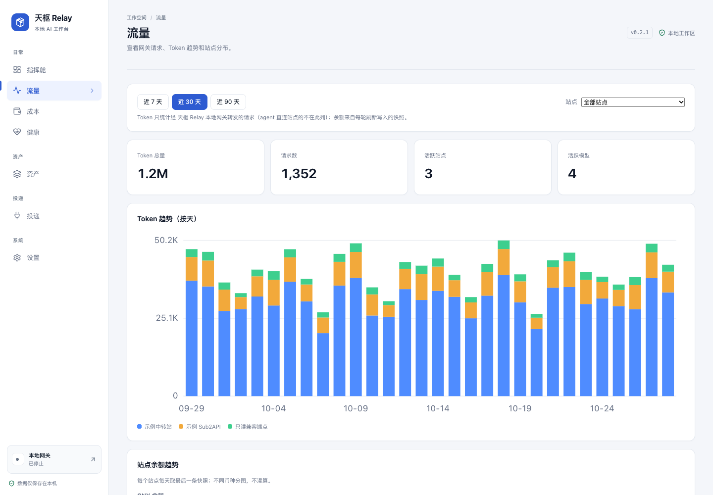

<p align="center">
  
</p>

<h1 align="center">天枢 Relay</h1>

<p align="center">
  中转站钥匙管家：把站点密钥安全地送到每一个 Agent。
</p>

<p align="center">
  <a href="https://github.com/lorek666/keyrelay/releases/latest"></a>
  <a href="https://github.com/lorek666/keyrelay/actions/workflows/ci-macos.yml"></a>
  <a href="https://github.com/lorek666/keyrelay/actions/workflows/ci-windows.yml"></a>
  
  
</p>

<p align="center">
  <a href="https://github.com/lorek666/keyrelay/releases/latest"><strong>下载最新版</strong></a>
  ·
  <a href="USER-MANUAL.md">用户手册</a>
  ·
  <a href="SECURITY.md">安全政策</a>
  ·
  <a href="CONTRIBUTING.md">参与贡献</a>
</p>



<p align="center"><sub>界面截图使用示例数据；实际界面以当前版本为准。</sub></p>

## 它是什么

你手里有两三个中转站账号，本机又装着好几个 AI 编程 Agent。每次换站、换 key 都要逐个改配置文件；改错一个就是静默 401，额度用完才发现没钱。

**天枢 Relay 把这套手工活收进一个本地桌面应用：**

- 登录 NewAPI / Sub2API 等中转站，拉取余额、分组和已有 Key；
- 跨站管理 Key 的创建、绑定、删除与轮换；
- 给 Codex、Claude Code、Cursor、OpenCode 等 Agent 一键注入配置；
- 写入前展示脱敏 diff，写入后回读校验，出问题可以字节级回滚；
- 不想让明文 Key 落盘时，让 Agent 只连本机网关。

无服务端、无账号体系、默认零遥测；业务数据只保存在本机。

## 为什么不是又一个 Key 记事本

| 手工管理 | 天枢 Relay |
| --- | --- |
| 换一把 Key 要改 N 个 Agent 配置文件 | 一次投递到全部已绑定 Agent，写前先看 diff |
| Key 明文散落在各个配置里 | 默认进本地加密保险库；网关模式下 Agent 只拿本地 token |
| 站点登录态失效只能靠猜 | 启动时校验会话，失效明确提示，验证码走官方页面 |
| 不知道哪把 Key 在用、哪把该删 | 资产页按站点、分组、状态、用量和绑定关系集中管理 |
| 换站要逐个 Agent 改地址 | 网关模式换后端即可，Agent 侧零改动 |
| 改坏配置只能手忙脚乱恢复 | 原子写入 + 写前备份 + journal，一键回滚到字节一致的旧文件 |

## 核心能力

- **站点接入**：填 `base_url` 自动识别 NewAPI 系、Sub2API 或自定义 OpenAI 兼容站点；支持 TOTP，撞上验证码时走内嵌 WebView 的官方页面，不绕过风控。
- **密钥生命周期**：跨站新建、查看、删除 Key；拉取站点分组与倍率；新建 Key 默认按 `<应用>/<agent>/<日期>` 命名；解绑 Agent 默认只解绑、不删除 Key。
- **安全投递**：探测 Agent → 生成 diff → 原子写入 → 回读校验；只改受管字段，保留配置文件里的其他内容、格式和注释；写前自动备份，变更历史可回滚。
- **本地网关**：在本机提供 OpenAI / Anthropic 兼容端点，Agent 只使用可撤销的 `local-` token；真实站点 Key 不出保险库。
- **多站路由**：按余额健康度、倍率、延迟（EWMA）选路；分 Agent 路由规则、重试预算、分站点超时、硬预算与成本估算。
- **运行监控**：站点余额、登录态、Key 健康、模型列表变化和网关流量统一看板；余额过低、登录失效等情况会提示。
- **模型名单**：内置模型窗口、最大输出、协议、思考档位和价格；可手动同步、本机覆盖，也可关闭自动同步。
- **本地优先**：无服务端依赖，默认零遥测，不记录请求/响应正文；诊断包导出前先脱敏。

## 界面一览

### 资产与投递

| 资产与密钥 | 投递与回滚 |
| --- | --- |
| [](assets/readme/assets.png) | [](assets/readme/delivery.png) |

### 流量与用量



## 安装

从 [Releases](https://github.com/lorek666/keyrelay/releases/latest) 下载最新版：

| 平台 | 安装包 | 要求 |
| --- | --- | --- |
| macOS Apple Silicon | `*_aarch64.dmg` | macOS 12+ |
| macOS Intel | `*_x64.dmg` | macOS 12+ |
| Windows | `*_x64-setup.exe` | Windows 10/11 |

装好后打开即用，不需要注册账号，也不需要部署服务端。后续更新由应用内更新通道推送，可在设置中开关自动更新。

## 快速上手

### 1. 接入站点

输入站点 URL，确认自动识别的站点类型，然后登录。需要 TOTP 时输入 6 位动态码；遇到验证码会在应用内打开官方页面，由你手动完成。

> TOTP 密钥不会保存在本机。第二因子留在你的验证器里，应用只保存登录后的会话凭证。

### 2. 拿一把 Key

在资产页选择已有 Key，或新建一把：选择分组、额度与过期时间。Key 的明文只存在本地加密保险库，列表和日志里只显示脱敏值。

### 3. 选择投递方式

| 方式 | 写入 Agent 的内容 | 适合谁 |
| --- | --- | --- |
| **本地网关（推荐）** | 本机网关地址 + 可撤销的 `local-` token | 不想让站点 Key 落进 Agent 配置；需要换站、故障切换 |
| **站点直写** | 站点 `base_url` + 站点 Key | 不想常驻网关；只用一个站点、偶尔手动换 Key |

### 4. 预览、应用、验证

选择 Agent 后先看脱敏 diff，确认要改的字段，再勾选同意并应用。应用会原子写入并回读校验；如果 Agent 起不来，在变更历史里一键回滚。

## 支持的站点

| 类型 | 说明 |
| --- | --- |
| NewAPI 系 | NewAPI 及 one-api / one-hub / veloera / donehub 等兼容实现 |
| Sub2API | Sub2API 实例，支持 TOTP / step-up 二次确认 |
| 自定义 OpenAI 兼容 | 兼容 OpenAI 风格的站点；余额不可观测时明确显示为未知 |

登录方式随站点能力变化：NewAPI 走加密登录，Sub2API 走账号登录。会话凭证只保存在本地；启动时静默校验，失效会标记并提示。

## 支持的 Agent

当前覆盖 **28 个投递通道**，其中 27 个可直写；Cline Desktop 暂不支持文件直写，请使用 `cline auth` CLI。

| Agent | 说明 |
| --- | --- |
| Codex CLI | `auth.json` 与 `config.toml` 一次投递 |
| Claude Code、Claude Desktop | 写入各自的设置文件 |
| OpenCode | `.json` 与 `.jsonc` 两个落点，预览时自选其一 |
| Gemini CLI、Grok、OpenClaw、Hermes、MCode、Pi | 按各自格式写入 |
| Cursor、Cline、Qwen Code、DeepSeek、Trae、MiMoCode、DeepSeek Harness | 按各自格式写入 |
| Qoder、Qoder CN、Kimi Code、Droid、CodeBuddy Code | 按各自格式写入 |
| WorkBuddy、WorkBuddy AI、Crush | 按各自格式写入；Crush 的 provider 与模型选择分开保存 |
| Cline Desktop | ⚠️ 暂不支持文件直写，请走 `cline auth` CLI |

不同 Agent 的生效策略不同：有的新会话即生效，有的需要重启。投递前界面会明确标注，应用不会替你杀掉正在运行的任务。

## 本地网关

网关模式是为“不想让明文 Key 落盘”准备的。

- 默认监听 `127.0.0.1:8787`，仅本机回环地址可访问。
- 兼容端点：`POST /v1/chat/completions`、`POST /v1/responses`、`POST /v1/messages`、`GET /v1/models`，支持 SSE 流式透传。
- 本地认证接受 `Authorization: Bearer <本地 token>`、`X-Tianshu-Relay-Token`，以及 Anthropic / Gemini / Azure 客户端常用的 `X-Api-Key`、`X-Goog-Api-Key`、`Api-Key`；这些头的值都必须是本地 token。
- 网关会剥离客户端带来的认证头，替换为当次命中的站点 Key；`X-Tianshu-Session` 只用于本地会话粘性，绝不转发给上游。
- 上游默认按 OpenAI Chat 协议转发；可在设置中显式选择 Anthropic Messages 同协议直通（实验）。不会根据模型名或响应猜测协议。
- 重放边界：只有 **HTTP 429** 或**确认请求未送达的连接失败**会在本次请求内切换候选；5xx、401、403、可能已送达的读超时一律原样返回，不重放，避免重复计费或重复执行。
- 成本控制：硬预算、重试预算、分站点超时、分 Agent 路由规则；账单对账与用量成本估算在成本页查看。

## 安全与隐私

| 边界 | 做法 |
| --- | --- |
| 密钥存储 | `vault.db` 存 AES-256-GCM 密文，`vault.key` 存设备绑定的数据密钥；元数据库只存引用，不存明文 |
| 配置写入 | 临时文件 + rename 原子落盘；写前备份；journal 支持字节级回滚 |
| 写入范围 | 只改受管字段；其他内容、格式和注释原样保留；外部改动过的文件不会被静默覆盖 |
| 用户同意 | 把 Key 写进 Agent 配置前必须显式勾选同意；危险操作二次确认 |
| 日志 | 请求日志默认只记元数据，不记正文；密钥、token、Authorization 头在写日志前脱敏 |
| 导出 | 导出包使用 AES-GCM 加密；诊断包不含密钥明文 |
| 遥测 | 默认零遥测，不采集 prompt 正文、密钥或使用内容 |
| 模型名单 | 自动同步只下载公开元数据，不上传密钥、设置或使用内容；失败保留旧名单 |

### 模型名单

启动约 20 秒后以及之后每 24 小时，应用会从公开仓库同步一次模型元数据（上下文窗口、最大输出、协议、思考档位与价格），缓存在本机数据目录。可以手动同步、按模型覆盖，或在「成本 → 内置模型名单」关闭自动同步。

未核对的参数按未知处理，不会擅自写入或删除用户配置。

## 常见问题

**Q：撞上站点验证码怎么办？**

A：不绕过。应用会打开内嵌 WebView 的官方页面，你手动完成验证后继续。

**Q：TOTP 每次都要输吗？**

A：是。TOTP 密钥不保存在本机，这是刻意的安全取舍。

**Q：注入后 Agent 需要重启吗？**

A：看 Agent。有的新会话即生效，有的需要重启；投递前界面会标注。应用不会替你结束正在运行的任务。

**Q：站点侧手工删了 Key 会怎样？**

A：下次刷新会把本地 Key 标记为缺失，不会继续使用一把不存在的 Key。

**Q：解绑 Agent 会删除站点上的 Key 吗？**

A：默认不会。解绑只解除绑定，可恢复；需要同时删除时要在确认框里另行勾选。

**Q：换站一定要逐个 Agent 改吗？**

A：不用。网关模式下改网关后端即可；站点直写模式下可以一键重新投递全部已绑定 Agent。

**Q：支持 Linux 吗？**

A：尽力而为，不作为当前发布验收项；正式发布目标是 macOS 与 Windows。

**Q：安全漏洞怎么报？**

A：不要公开提 Issue，按 [SECURITY.md](SECURITY.md) 走 GitHub 私密漏洞上报。

## 开发

### 环境要求

- Rust 1.89+（以 `Cargo.toml` 的 `rust-version` 为准）
- Node.js 20+、pnpm 9+
- macOS 12+ 或 Windows 10+（Tauri 依赖系统 WebView）

### 常用命令

```bash
pnpm install                         # 安装前端依赖
pnpm build                           # tsc --noEmit + vite build
pnpm test                            # 前端与仓库守护脚本
pnpm tauri dev                       # 启动桌面端开发

cargo test --workspace --no-fail-fast # 全部 Rust 测试
cargo clippy --workspace --all-targets -- -D warnings
cargo fmt --check --all
```

前端单测与检查脚本可通过 `CI=true pnpm test` 运行；模型名单与命令清单另有独立守护脚本。

### 目录结构

```text
crates/tianshu-relay-core/   # 纯逻辑：站点适配器、投递器、保险库、存储
crates/tianshu-relay-cli/    # 命令行：冒烟、迁移与运维入口
src-tauri/                   # Tauri 2 桌面壳与平台胶水
src/                         # React + Vite 前端
assets/readme/               # README 截图
scripts/                     # CI 门禁与仓库守护脚本
```

### 贡献

工程流程是 **spec 先行**：先写 spec，再实现，再独立复审。提交 PR 前请阅读 [CONTRIBUTING.md](CONTRIBUTING.md)，并确认 macOS / Windows 两套 CI 门禁通过。

## 相关文档

- [用户手册](USER-MANUAL.md)
- [安全政策](SECURITY.md)
- [贡献指南](CONTRIBUTING.md)
- [行为准则](CODE_OF_CONDUCT.md)

## 许可证

MIT，见 [LICENSE](LICENSE)。
