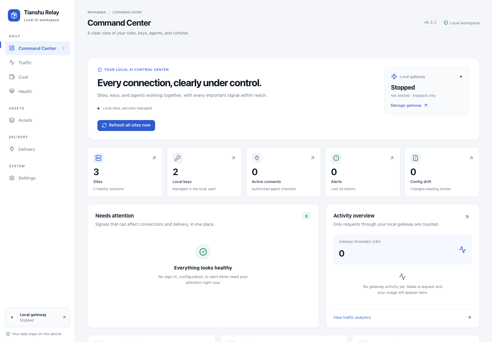
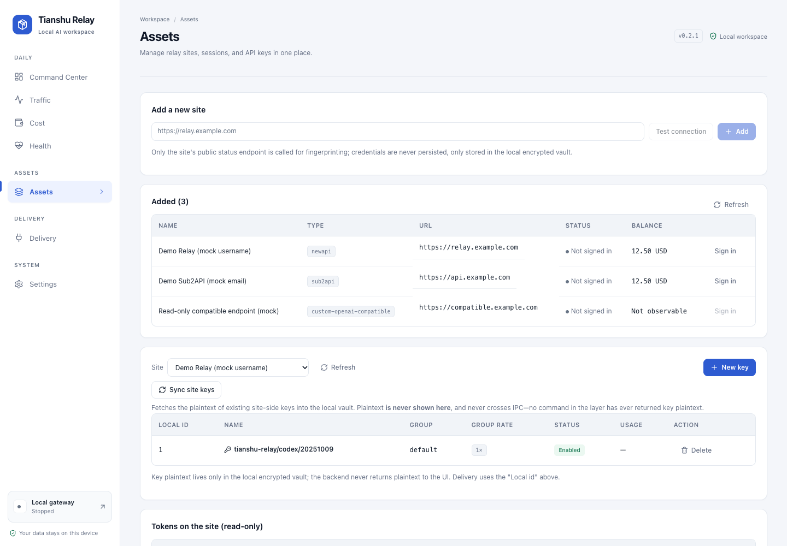
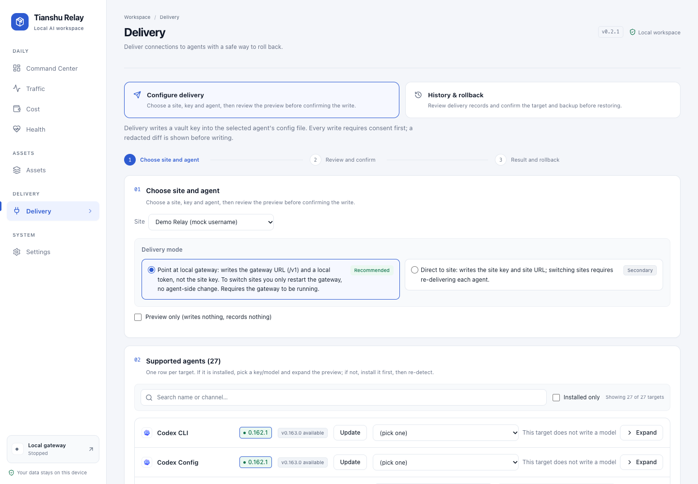
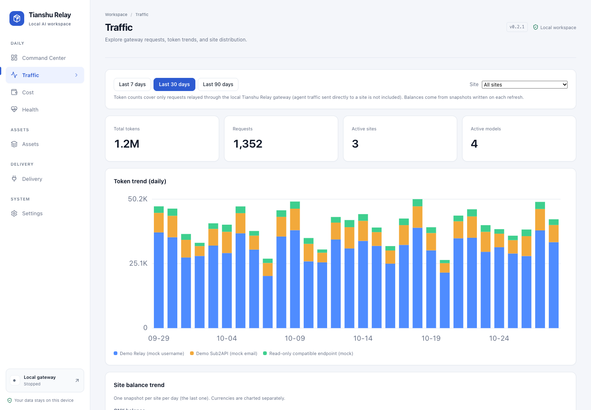

<p align="center">
  
</p>

<h1 align="center">Tianshu Relay</h1>

<p align="center">
  <a href="README.md"><strong>English</strong></a> · <a href="README.zh-CN.md">简体中文</a>
</p>

<p align="center">
  The key manager for relay sites: deliver site keys to every coding agent, safely.
</p>

<p align="center">
  <a href="https://github.com/lorek666/keyrelay/releases/latest"></a>
  <a href="https://github.com/lorek666/keyrelay/actions/workflows/ci-macos.yml"></a>
  <a href="https://github.com/lorek666/keyrelay/actions/workflows/ci-windows.yml"></a>
  
  
</p>

<p align="center">
  <a href="https://github.com/lorek666/keyrelay/releases/latest"><strong>Download latest</strong></a>
  ·
  <a href="USER-MANUAL.md">User manual</a>
  ·
  <a href="SECURITY.md">Security</a>
  ·
  <a href="CONTRIBUTING.md">Contributing</a>
</p>



<p align="center"><sub>Screenshots use sample data; the live UI may differ slightly by version.</sub></p>

## What it is

You have two or three relay-site accounts and several AI coding agents on your machine. Every time you switch sites or rotate a key, you edit config files one by one; one typo becomes a silent 401, and you only notice when the quota is gone.

**Tianshu Relay puts that manual work into one local desktop app:**

- Sign in to NewAPI / Sub2API relay sites and pull balances, groups, and existing keys;
- Create, bind, delete, and rotate keys across sites;
- Inject config into Codex, Claude Code, Cursor, OpenCode, and other agents in one click;
- Review a redacted diff before writing, then verify the result by reading the file back;
- Roll back to a byte-identical previous config when an agent stops working;
- Keep plaintext keys out of agent configs by routing agents through the local gateway.

No server, no account system, zero telemetry by default; business data stays on your machine.

## Why another key manager?

| Manual workflow | Tianshu Relay |
| --- | --- |
| Rotating one key means editing N agent config files | Deliver to every bound agent at once, with a diff first |
| Keys sit in plaintext across config files | Keys live in an encrypted local vault; gateway mode gives agents only a local token |
| Site sessions expire without warning | Sessions are checked on startup; captcha opens the official page |
| No idea which key is in use or should be deleted | The assets view tracks site, group, status, usage, and bindings |
| Switching sites means editing every agent | Gateway mode switches the backend; agent config stays unchanged |
| A broken config means manual recovery | Atomic writes + backup + journal; byte-identical rollback |

## Features

- **Site onboarding**: enter a `base_url` and detect NewAPI, Sub2API, or a custom OpenAI-compatible site. TOTP is supported; captcha challenges open the official page in an embedded WebView instead of being bypassed.
- **Key lifecycle**: create, inspect, delete, and rotate keys across sites; pull groups and rates; new keys default to `<app>/<agent>/<date>`; unbinding an agent does not delete the key.
- **Safe delivery**: detect the agent, generate a diff, write atomically, then read back and verify. Only managed fields change; other content, formatting, and comments are preserved. Every write has a backup and a journal.
- **Local gateway**: expose OpenAI / Anthropic-compatible endpoints on loopback; agents use a revocable `local-` token while real site keys stay in the vault.
- **Multi-site routing**: route by balance health, rate, and latency (EWMA); per-agent rules, retry budgets, per-site timeouts, hard budgets, and cost estimates.
- **Observability**: balances, session state, key health, model-list changes, and gateway traffic in one dashboard; low balance and expired sessions are surfaced early.
- **Model catalog**: context windows, max output, protocol, thinking levels, and prices; sync manually, override per model, or disable automatic sync.
- **Local-first**: no server dependency, zero telemetry by default, no request/response body logging; diagnostic exports are redacted before they leave the app.

## Screenshots

### Assets and delivery

| Assets and keys | Delivery and rollback |
| --- | --- |
| [](assets/readme/en/assets.png) | [](assets/readme/en/delivery.png) |

### Traffic and usage



## Install

Download the latest build from [Releases](https://github.com/lorek666/keyrelay/releases/latest):

| Platform | Package | Requirement |
| --- | --- | --- |
| macOS Apple Silicon | `*_aarch64.dmg` | macOS 12+ |
| macOS Intel | `*_x64.dmg` | macOS 12+ |
| Windows | `*_x64-setup.exe` | Windows 10/11 |

Open the app and go. No account or server is required. Updates are delivered by the in-app updater, which can be toggled in Settings.

## Quick start

### 1. Connect a relay site

Enter the site URL, confirm the detected site type, and sign in. If TOTP is required, enter the 6-digit code. Captcha challenges open the official page inside the app and wait for you to finish.

> TOTP secrets are never stored on your machine. The second factor stays in your authenticator; the app only stores the resulting session.

### 2. Get a key

Pick an existing key in the assets view, or create one with a group, quota, and expiry. The plaintext key lives only in the encrypted local vault; lists and logs show masked values.

### 3. Choose a delivery mode

| Mode | What gets written to the agent | Best for |
| --- | --- | --- |
| **Local gateway (recommended)** | Local gateway URL + a revocable `local-` token | Keeping site keys out of agent configs; switching sites or failing over |
| **Direct site** | Site `base_url` + site key | Avoiding a long-running gateway; one site, occasional manual rotation |

### 4. Preview, apply, verify

Select an agent and review the redacted diff before granting consent and applying. The app writes atomically and verifies by reading the file back. If the agent breaks, open the change history and roll back.

## Supported relay sites

| Type | Notes |
| --- | --- |
| NewAPI family | NewAPI and compatible implementations such as one-api, one-hub, veloera, and donehub |
| Sub2API | Sub2API instances, including TOTP / step-up confirmation |
| Custom OpenAI-compatible | OpenAI-style sites; unobservable balances are shown as unknown |

Login behavior follows site capabilities: NewAPI uses encrypted login, Sub2API uses account login. Session credentials stay local and are checked silently on startup; expired sessions are marked and surfaced.

## Supported agents

Tianshu Relay covers **28 delivery channels**, 27 of which support direct file writes. Cline Desktop is the exception and currently requires the `cline auth` CLI.

| Agent | Notes |
| --- | --- |
| Codex CLI | `auth.json` and `config.toml` delivered together |
| Claude Code, Claude Desktop | Write to their respective settings files |
| OpenCode | `.json` and `.jsonc` are separate targets; choose one in preview |
| Gemini CLI, Grok, OpenClaw, Hermes, MCode, Pi | Written in each tool's native format |
| Cursor, Cline, Qwen Code, DeepSeek, Trae, MiMoCode, DeepSeek Harness | Written in each tool's native format |
| Qoder, Qoder CN, Kimi Code, Droid, CodeBuddy Code | Written in each tool's native format |
| WorkBuddy, WorkBuddy AI, Crush | Written in each tool's native format; Crush keeps provider and model selection in separate files |
| Cline Desktop | ⚠️ No direct file write yet; use `cline auth` |

Restart behavior varies by agent: some pick up the change in a new session, others need a restart. The delivery screen states which case applies; Tianshu Relay never kills a running task for you.

## Local gateway

Gateway mode is for users who do not want plaintext keys written into agent configs.

- Listens on `127.0.0.1:8787` by default; loopback only.
- Compatible endpoints: `POST /v1/chat/completions`, `POST /v1/responses`, `POST /v1/messages`, and `GET /v1/models`, with SSE streaming passthrough.
- Local auth accepts `Authorization: Bearer <local token>`, `X-Tianshu-Relay-Token`, and the `X-Api-Key` / `X-Goog-Api-Key` / `Api-Key` headers used by Anthropic, Gemini, and Azure clients. Every value must be a local token.
- Client auth headers are stripped and replaced with the site key selected for that request. `X-Tianshu-Session` is local-only and is never forwarded upstream.
- Upstream traffic uses OpenAI Chat by default. Anthropic Messages passthrough can be selected explicitly in Settings (experimental); the protocol is never guessed from a model name or response.
- Replay boundary: only **HTTP 429** and **connection failures confirmed not to have been delivered** may switch candidates within the same request. 5xx, 401, 403, and read timeouts that may already have been delivered are returned unchanged and never replayed, avoiding duplicate billing or execution.
- Cost controls: hard budgets, retry budgets, per-site timeouts, and per-agent routing rules; reconciliation and usage cost estimates live on the Cost page.

## Security and privacy

| Boundary | Implementation |
| --- | --- |
| Key storage | `vault.db` stores AES-256-GCM ciphertext; `vault.key` stores a device-bound data key; the metadata database stores references, never plaintext |
| Config writes | Temp file + rename for atomic writes; backup before write; journal enables byte-identical rollback |
| Write scope | Only managed fields change; other content, formatting, and comments are preserved; externally modified files are never overwritten silently |
| Consent | Writing a key into an agent config requires explicit consent; destructive actions require confirmation |
| Logs | Request logs contain metadata only, never bodies; keys, tokens, and Authorization headers are redacted before logging |
| Exports | Export bundles use AES-GCM encryption; diagnostic bundles contain no plaintext keys |
| Telemetry | Zero telemetry by default; no prompt bodies, keys, or usage content are collected |
| Model catalog | Automatic sync downloads public metadata only and never uploads keys, settings, or usage content; failures keep the previous catalog |

### Model catalog

About 20 seconds after startup, and every 24 hours thereafter, the app syncs model metadata (context window, max output, protocol, thinking levels, and prices) from the public catalog and caches it in the local data directory. You can sync manually, override individual models, or turn off automatic sync under **Cost → Built-in model catalog**.

Unverified values are treated as unknown and are never written into or removed from user configuration automatically.

## FAQ

**Q: What happens when a site shows a captcha?**

A: Tianshu Relay does not bypass it. It opens the official page in an embedded WebView and continues after you finish the challenge.

**Q: Do I have to enter TOTP every time?**

A: Yes. TOTP secrets are not stored locally; this is a deliberate security trade-off.

**Q: Does an agent need a restart after delivery?**

A: It depends on the agent. Some pick up changes in a new session, others need a restart. The delivery screen labels the requirement, and the app does not terminate running tasks.

**Q: What if I delete a key on the site?**

A: The next refresh marks the local key as missing; Tianshu Relay will not keep using a key that no longer exists.

**Q: Does unbinding an agent delete the site key?**

A: No, not by default. Unbinding only removes the binding and is reversible. Deleting the key requires a separate confirmation.

**Q: Do I have to edit every agent when switching sites?**

A: No. In gateway mode, switch the gateway backend; in direct mode, re-deliver to every bound agent in one action.

**Q: Is Linux supported?**

A: Best effort, but not a release acceptance target today. The supported release platforms are macOS and Windows.

**Q: How do I report a security issue?**

A: Do not open a public issue. Follow [SECURITY.md](SECURITY.md) and use GitHub's private vulnerability reporting.

## Development

### Requirements

- Rust 1.89+ (see `rust-version` in `Cargo.toml`)
- Node.js 20+ and pnpm 9+
- macOS 12+ or Windows 10+ (Tauri uses the system WebView)

### Common commands

```bash
pnpm install                         # install frontend dependencies
pnpm build                           # tsc --noEmit + vite build
pnpm test                            # frontend tests and repository guards
pnpm tauri dev                       # run the desktop app in development

cargo test --workspace --no-fail-fast # all Rust tests
cargo clippy --workspace --all-targets -- -D warnings
cargo fmt --check --all
```

Frontend unit tests and guard scripts can also run with `CI=true pnpm test`. The model catalog and command registry have dedicated checks.

### Project layout

```text
crates/tianshu-relay-core/   # pure logic: site adapters, delivery, vault, storage
crates/tianshu-relay-cli/    # CLI: smoke tests, migration, operations
src-tauri/                   # Tauri 2 desktop shell and platform glue
src/                         # React + Vite frontend
assets/readme/               # localized README screenshots
scripts/                     # CI gates and repository guards
```

### Contributing

The workflow is **spec first**: write a spec, implement, then get an independent review. Read [CONTRIBUTING.md](CONTRIBUTING.md) before opening a PR and make sure both macOS and Windows CI gates pass.

## Documentation

- [User manual](USER-MANUAL.md)
- [Security policy](SECURITY.md)
- [Contributing guide](CONTRIBUTING.md)
- [Code of conduct](CODE_OF_CONDUCT.md)

## License

MIT, see [LICENSE](LICENSE).
